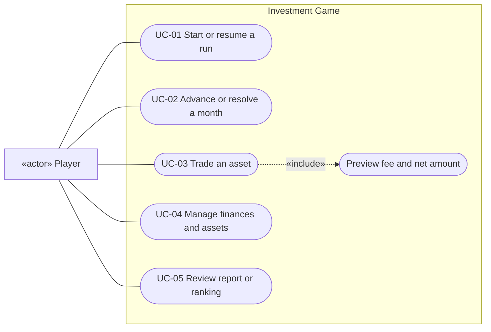

# Investment Game Software Requirements Document

CAT404 Investment Game · CSE441 Software Process and Quality Assurance

Use this specification as technical evidence for CSE441 report Sections 3 and 4. The assignment also asks for front matter, project background and module breakdown, a justified process model and ten-week plan, product/project/process metrics, GUI evidence, conclusions, references and appendices. Develop those sections in the individual report. The rubric's top band for GUI evidence calls for more than four described screenshots or proposed screens.

**Goal.** Help students and young adults explore the effect of monthly financial decisions across life stages.

- **O1.** Implement a shared monthly financial model with independent saved progress.
- **O2.** Evaluate gameplay tasks, financial report interpretation and concurrent play.

Virtual RM is used throughout. The scope covers simulated trades, banking, property, small businesses and retirement. Real trades, payments and live market feeds are outside project scope.

## 3 Software Requirements Specifications

### 3.1 System requirements

#### 3.1.1 Functional requirements

| ID | Module | Required behaviour |
| --- | --- | --- |
| FR-01 | Account and save | Allow a guest or registered player to start, save and resume a run. Choose Full Life (22–80), Early Career (22–45), Wealth Building (45–60) or Retirement (60–80), with Easy, Normal, Hard or Expert and Standard or Free. Load opening balances from the proposal's mode and difficulty tables. |
| FR-02 | Monthly settlement | Advance one month, or repeat that settlement up to three times. Apply salary, living costs, obligations, market changes and applicable property/business events. Save each completed month. Pause for a required decision or overdue bill and preserve unfinished turns. Work salary stops at 60. Stop at the selected end age. |
| FR-03 | Markets and ordinary trading | Present 15 simulated instruments, monthly prices and prepared news. Validate cash and unlocked units. Stocks and non-crypto assets trade in whole units. Crypto uses steps of 0.01 coin. Holdings acquired this month unlock next month. Preview trade value, fee and net amount. Charge 0.25% per executed buy or voluntary sale, rounded to the nearest sen, minimum RM1.00. |
| FR-04 | Leveraged trades | Permit long-only leverage up to 2× for stock, gold and commodities and 3× for crypto. Calculate open and voluntary close fees on full traded value. Require margin plus fee on opening. Deduct fees from equity on voluntary close and check available cash for any shortfall. Add no extra fee on forced liquidation. |
| FR-05 | Property | Support purchase, financing, rent, vacancy and maintenance. Queue voluntary sales for the next settlement. Deduct 2% and outstanding mortgage principal before crediting cash. |
| FR-06 | Financial reports | Use opening and completed-month records for the wealth history. Show wealth, benchmark and the score breakdown. Show monthly and cumulative recorded fees as a subset of recorded expenses in the report and CSV. A paused month's fees enter the figures when that month is recorded. |
| FR-07 | Banking and business | Support deposits, retirement savings, amortising loans, business operations and distributions. Transfers and principal movements do not add income. Settle business sales next month with a 3% fee. |
| FR-08 | Scoring and leaderboard | Weight wealth, risk, cash flow and debt at 60%, 15%, 15% and 10%. Publish each player's best eligible completed Standard result per mode and difficulty using the current market model. Keep Free, unfinished and bankrupt runs off the leaderboard. |

#### 3.1.2 Non-functional requirements

| ID | Attribute | Acceptance target |
| --- | --- | --- |
| NFR-01 | Correctness and recovery | Round monetary ledger entries to the nearest sen. Repeating an accepted request preserves the original state change and fee total. Save and resume a paused game without processing the same month twice. |
| NFR-02 | Isolation and concurrency | Reject access to another player's save. In the course demonstration, 20 separate accounts should each complete 12 months with one opening record and 12 closing records. Record request outcomes and latency for that workload. |
| NFR-03 | Browser usability | At 390 × 844 and 1440 × 1000, complete setup, trade preview, month advancement, resumption and report review. Important controls remain readable and usable without page-level horizontal overflow. Record assistance and layout defects. |

### 3.2 Use case modelling

#### 3.2.1 Use case diagram

The player may participate as a guest or a registered user. The system boundary groups the actions available to both.

#### 3.2.2 Use case descriptions

| ID | Actor and preconditions | Main flow | Alternate flow | Postcondition |
| --- | --- | --- | --- | --- |
| UC-01 | Player has a guest or signed-in session | Choose mode, difficulty and scenario. Open the dashboard or select an owned saved run. | If the run is inaccessible, show an error and offer the player's own game list. | Exactly one run is created or the selected run resumes with its prior state. |
| UC-02 | Player owns a live run | Select one or three months. Apply monthly events and settle each turn. Display the new balance and history. | Pause on an unresolved event or bill. Resolve it and resume the remaining turns. Stop if the run completes or becomes bankrupt. | Each finished month is saved once. Pending state survives reloading. |
| UC-03 | Player owns an active run and selects a tradable instrument | Enter side, quantity and optional leverage. Review fee and net amount. Confirm. Validate and update cash, holding or position and the fee ledger. | Reject invalid quantity, locked units, insufficient cash or excess leverage. A confirmed request retry returns its prior result. | Accepted trade is saved once. Rejected orders leave balances and holdings intact. |
| UC-04 | Player owns a run with an eligible action | Choose a bank, property or business action. Review amount and confirm. Queue sales for the next month. | Reject ineligible actions. A cash shortfall during settlement may pause the game. | Holdings and liabilities reflect accepted actions. Pending sales show their status. |
| UC-05 | Player has an owned run or opens the shared leaderboard | Review the balance sheet, monthly records, fee totals and scores. Download CSV if desired. On leaderboard, select mode and difficulty. | Empty monthly history still permits viewing the opening baseline. Ineligible runs remain off the leaderboard. | Display and CSV agree with the saved records used for the report. |

## 4 Requirement Traceability Matrix

| Requirement | Objective | Use case | Acceptance test or evidence |
| --- | --- | --- | --- |
| FR-01 | O1 | UC-01 | AT-01. Start one game per mode. Compare the starting age and balance with proposal tables. Reload a saved run and compare its state. |
| FR-02 | O1 | UC-02 | AT-02. Compare three single advances with a three-month advance under identical events. Trigger a pause and resume without duplicating a month. |
| FR-03 | O1 | UC-03 | AT-03. RM1,000 buy debits RM1,002.50. Equivalent sale credits RM997.50. RM200 trade charges RM1.00. An immediate sale of new holdings fails. |
| FR-04 | O1 | UC-03 | AT-04. A RM1,000 exposure at 2× needs RM500 margin and RM2.50 fee. Reject close if cash cannot cover the shortfall. Forced liquidation adds zero fee. |
| FR-05 | O1 | UC-04 | AT-05. On a RM250,000 settlement valuation with RM100,000 mortgage, sale credits RM145,000. The balance changes at settlement. |
| FR-06 | O2 | UC-05 | AT-06. Execute a RM1,000 and RM200 buy in different months. After both settle, the reports page and CSV should show RM2.50 and RM1.00, and RM3.50 cumulative. Verify the fees are already included in expenses. |
| FR-07 | O1 | UC-04 | AT-07. A transfer preserves net worth. A business sale at RM10,000 credits RM9,700 at monthly settlement. |
| FR-08 | O2 | UC-05 | AT-08. Test completed Standard, Free and bankrupt runs. Only the best eligible Standard result appears. |
| NFR-01 | O1 | UC-02, UC-03 | AT-09. Resend an accepted trade request. Verify one change to cash and fees. Resume a saved pause and count monthly records. |
| NFR-02 | O2 | UC-01, UC-02 | AT-10. Run the 20-player exercise and check all final record counts. Confirm a cross-account request is denied. |
| NFR-03 | O2 | UC-01–UC-05 | AT-11. Repeat the browser walkthrough on desktop and mobile. Record the outcome and any UI defects. |

Repository evidence: native tests via `npm test`, browser walkthrough via `npm run test:browser`, and local concurrency exercise via `npm run test:load`. Record execution status and observed results separately from these acceptance criteria.
